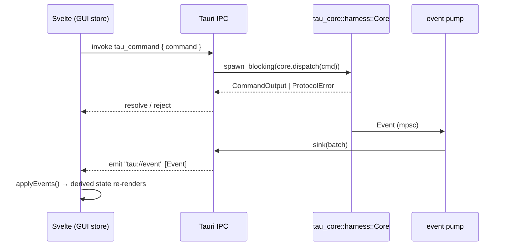

# Tau protocol reference

The complete wiring between the core and the GUI: every command, every event, every shared
type, and the seams that carry them. Source of truth is the crate, not this page —
[`crates/tau-protocol`](../crates/tau-protocol/src) is the protocol, this page is the map of it.
The contract it satisfies is [spec §8](spec/v0.md); the shape decision is
[ADR-0006](adr/0006-core-gui-protocol-single-message-crate.md).

**Read this with the code open.** The Rust enums and the TypeScript mirrors are field-for-field
matched by `app/svelte/scripts/protocol-parity.mjs`, which CI's frontend job runs directly
(`.github/workflows/ci.yml`, the "Protocol parity" step). A new variant in the crate that the GUI
has no mirror for fails that check — so this page cannot drift from the code either.

---

## 1. The boundary

- **One crate of tagged-union messages** — `tau-protocol`. Commands in, events out. No transport
  types, no Tauri types, no core types (ADR-0006).
- **`tau-core` owns all state.** The app is a client of the core; the GUI is a stateless renderer
  rebuildable from *snapshot + event stream*, never the other way around (spec §8).
- **The GUI compiles against the protocol types alone.** There is no richer in-process API — no
  two-surface drift. The Svelte mirror is [`app/svelte/lib/wire/protocol.ts`](../app/svelte/lib/wire/protocol.ts).
- **No protocol version field.** Pre-v1 is breakable (spec §8). Forward compatibility is carried
  per-type instead: `EntryKind::Other` and `Diagnostic::Unknown` keep an unknown line loading,
  `#[serde(default)]` carries every field added to an existing struct.

### Serde conventions

| Item | Tag | Case |
|---|---|---|
| `Command` | `type` | `snake_case` |
| `CommandOutput` | `kind` | `snake_case` |
| `Event` | `type` | `snake_case` |
| `SessionEventKind` / `SystemEventKind` / `SubagentEventKind` | `kind` | `snake_case` |
| `ProtocolError` | `kind` | `snake_case` |
| `Diagnostic` | `code` | `snake_case` |
| Entry kinds (on-disk, ADR-0005) | — | `user` `assistant` `tool` `system` `om` `subagent` `spawn-snapshot` `diagnostic` |

Struct-variant payloads are **named-field struct variants, never newtypes**. `CommandOutput` is
internally tagged, and serde merges the tag into the map — a newtype variant would flatten its
fields to the top level and break the GUI's field-name contract.

An unknown tag is a **data error**, never a silent no-op: the snapshot self-heal that makes the
event stream loss-tolerant only works if bad frames fail decode. See
`crates/tau-protocol/src/tests.rs`, `events.rs::event_unknown_type_is_data_error`.

---

## 2. Transport

### Transport #1 — Tauri (the app)

The Tauri surface is one command and one event channel — a `#[tauri::command]` that takes a
`Command`, and an `emit` of an `Event[]` batch.

| Direction | Route | Code |
|---|---|---|
| GUI → core | `invoke('tau_command', { command })` → `Result<CommandOutput, ProtocolError>` | [`app/src-tauri/src/lib.rs`](../app/src-tauri/src/lib.rs) |
| core → GUI | `emit('tau://event', batch)` — a batch is `Event[]` | [`app/src-tauri/src/main.rs`](../app/src-tauri/src/main.rs) |

- **One command carries any `Command`.** The IPC surface is one entry point, not a command-per-verb
  list (the reviewable-decision rule in AGENTS.md applies once, not 37 times).
- `tau_command` is `async` and clones the `Arc<Core>` handle **before** `spawn_blocking`, so a
  command wedged on a lock ties up a throwaway thread, never a runtime worker the drive tasks and
  provider timeouts need.
- **`CoreState(pub Arc<Core>)`** exists because rustc 1.98.1 computes `TypeId::of::<Arc<Core>>()`
  per instantiating crate; a generic's `TypeId` never matches the map key Tauri's `try_state`
  computes, and `state()` panics at launch. A non-generic wrapper's `TypeId` is stable.
- **The pump** ([`harness/pump.rs`](../crates/tau-core/src/harness/pump.rs)) is a plain forward:
  one event in, one event out. The 25 ms coalescer is gone — frame alignment is the turn loop's
  job under ADR-0008, so nothing batches on the way out.
- **Capabilities**: `core:event:allow-listen`, `core:event:allow-unlisten`, `dialog:allow-open`,
  `opener:allow-open-url`, `core:window:allow-start-dragging`, `core:window:allow-is-fullscreen`
  ([`capabilities/default.json`](../app/src-tauri/capabilities/default.json)). The pilot/WDIO
  permissions are a separate `e2e` capability that `build.rs` generates only for `--features e2e`
  builds and deletes otherwise, so a release artifact can never carry them (sweep finding X1).
- One non-protocol event exists outside the schema: `emit("open_folder_requested", ())`, from the
  native File ▸ Open Folder… menu item to the frontend's dialog plugin.

### Transport #2 — ACP stdio (`tau acp`)

The headless branch is taken **first in `main`**, before any Tauri init: ACP's transport is the
process stdout, so no wry/tauri path may touch it. JSON-RPC 2.0, newline-delimited
([`crates/tau-acp/src/transport.rs`](../crates/tau-acp/src/transport.rs)); every log line goes to
stderr. It drives the **same dispatch protocol**, mapped to ACP's `session/update` notifications
by its own pump ([`crates/tau-acp/src/pump.rs`](../crates/tau-acp/src/pump.rs)). A stall long
enough to drop events surfaces as a `System` overflow error, which settles the turn.

### Transport #3 — dev browser (no Tauri window)

`isTauri()` gates it: a plain browser page runs the GUI with no window. The store exposes
`window.__tau` as a test/dev seam that feeds the same decoder path (`window.__tau.omStatus`,
`.sessionSetModel`, …). The GUI test suite drives the real debug binary over embedded WebDriver
instead — tauri-pilot is the agent's direct route, never a test driver (AGENTS.md, "The line").

---

## 3. Commands

`Command` → `dispatch` ([`crates/tau-core/src/harness/dispatch.rs`](../crates/tau-core/src/harness/dispatch.rs))
routes to four domain arms: `dispatch_workspace` and `dispatch_misc` in `dispatch.rs`,
`dispatch_session` in `dispatch_sessions.rs`, `dispatch_command` (messages, sub-agents) in
`dispatch_commands.rs`. Every arm answers `CommandOutput` or refuses `ProtocolError`.

Identity is always the **workspace object** (`id`, `name`, `cwd`-on-host) — never a bare path
(spec §8). `session` and `handle` are ids the core minted.

| Group | Command | Payload | Answers |
|---|---|---|---|
| Workspace | `workspace_open` | `cwd` | `workspace` |
| | `workspace_list` | — | `workspaces` |
| | `workspace_close` | `workspace` | `none` |
| Session | `session_list` | `workspace` | `sessions` |
| | `session_new` | `workspace`, `title?`, `base_prompt?` | `session` |
| | `session_rename` | `session`, `title` | `none` |
| | `session_set_model` | `session`, `model` | `none` |
| | `session_open` | `session` | `snapshot` |
| | `session_close` | `session` | `none` |
| | `session_delete` | `session` | `none` |
| | `session_archive` | `session` | `session` (flag set) |
| | `session_restore` | `workspace`, `session` | `session` (fresh meta) |
| | `session_fork` | `session`, `at` | `session` (new leaf) |
| | `session_branch` | `session`, `at` | `session` (new leaf) |
| | `session_snapshot` | `session` | `snapshot` |
| | `session_entries` | `session`, `since` **XOR** `range` | `entries` |
| | `blob_read` | `workspace`, `id`, `hash` | `blob` (`Value`) |
| Message | `message_send` | `session`, `text`, `lane` | `none` |
| | `message_stop` | `session` | `none` |
| | `queue_item_remove` | `session`, `index` | `none` |
| Sub-agent | `subagent_types` | — | `agents` |
| | `subagent_list` | `session` | `subagents` |
| | `subagent_state` | `handle` | `subagent` |
| | `subagent_spawn` | `session`, `agent_type`, `brief`, `context_mode` | `subagent` |
| | `subagent_message` | `handle`, `text?` | `subagent` |
| | `subagent_stop` | `handle` | `subagent` |
| | `subagent_activity` | `handle` | `subagent_activity` |
| Skills | `skill_list` | `workspace` | `skills` |
| Providers | `provider_list` | `workspace` | `providers` |
| | `provider_add` | `name`, `base_url`, `key_env`, `models` | `unsupported` |
| | `provider_set` | `name`, `base_url`, `key_env`, `models` | `unsupported` |
| | `provider_delete` | `name` | `unsupported` |
| Files | `file_read` | `workspace`, `path`, `offset?`, `limit?` | `file` (`{text, truncated}`) |
| | `file_list` | `workspace`, `path` | `files` |
| | `file_unlist` | `workspace`, `path` | `none` |
| Git | `git_status` | `workspace` | `git_status` |
| | `git_show` | `workspace`, `path` | `git_show` (`text`) |

`CommandOutput` variants, all named-field: `none` · `workspace` · `workspaces` · `session` ·
`sessions` · `snapshot` · `entries` · `blob` · `providers` · `agents` · `skills` · `subagent` ·
`subagent_activity` · `subagents` · `file` · `files` · `git_status` · `git_show`.

**Rules the commands encode.**

- **Paged reads only.** `session_entries` takes exactly one of `since` (the durable cursor = the
  last entry id seen) or `range` (`{start, count}`). There is no full-dump command (spec §8).
- **`file_read` is line-streamed with a 1 MB cap**; `truncated` marks lost content — a short file
  is not truncation. `path` is absolute or workspace-relative, resolved against the workspace
  `cwd`; every `FileEntry.path` returned is workspace-relative (root = `.`), so the GUI never
  learns a host path.
- **`file_list` is per-dir** (the files pane's lazy tree); `file_unlist` releases a dir's watcher —
  the watcher set is the GUI's authority, not the core's guess.
- **`subagent_activity`** (#203) returns the child's observation-log tail plus the un-observed raw
  tail, compact and tail-capped. Renderer-only: no LLM tool, zero model-context cost.
- **Providers are config-file-driven, read-only across the seam.** `provider_list` answers the
  workspace's config (`ProviderInfo {name, base_url, models}`) with no key material (§8) — `key_env`
  names an environment variable, the key never crosses the seam. `provider_add` / `_set` / `_delete`
  are on the surface from spec §8 and answer `ProtocolError::Unsupported` ("v0 providers are
  config-file-driven", `dispatch.rs`) — the GUI edits `config.toml`, and the config watcher's
  `provider_changed` event carries the swap to the model menu (#337).
- **Archive is parent-scoped and one-way** (ADR-0005): a child id is refused outright (archive the
  parent); a session with a running turn is refused, and a running *child* is refused **before
  anything is quiesced** — a stop is terminal, so a refused request must mutate nothing. Children
  archive and restore with the parent; a never-opened or closed session's archive is a pure file
  operation; restore needs an archive file and no live file.
- **A running turn also refuses the header rewrites** — `session_rename`, `session_fork`,
  `session_branch`, since a header rewrite races the turn's `append_line`. `session_fork` rechecks
  the flag after opening the store: a wake that starts a turn inside that window is refused, not
  silently branched from a stale leaf.
- **Lanes**: `message_send` takes `lane` ∈ `force` | `steering` | `follow_up` — the composer's
  3-way selector (spec §7). Force kills the in-flight stream (partial kept `interrupted`), steering
  lands after the current tool batch, follow-up after all agent work.
- **`subagent_message {handle, text?}`**: a running child takes it on its steering lane; a
  non-running child is resumed by it (no `text` = a pure resume). `handle` is the child's name;
  its session id is accepted as a fallback.
- **`context_mode`** ∈ `fresh` (default) | `compacted` | `fork` (spec §5.1).
- **`session_set_model`** is a no-op for the model already in force; otherwise it writes the meta,
  records a `model_changed` diagnostic, and rebinds the provider endpoint **from the next call** —
  an in-flight stream keeps the endpoint it started on, so the switch lands at the turn boundary
  (#336). A model id whose prefix names no configured provider is refused before anything moves.
- **`queue_item_remove` refuses a child session** — its queue is the parent's projection, so there
  is no top-level delete for a child. An out-of-range index (the item was consumed first) is a
  specific refusal, never a silent success.
- **`blob_read`** decompresses the sidecar and answers the parsed `Value`; a missing file is
  `NotFound` (the entry keeps its pointer, the card renders `unavailable`), a hash mismatch is
  `Other`.
- **`file_list` arms the watcher** for the dir it answers (`watch_tree_dir`); the pane's expanded
  set *is* the watch set, so `file_tree_changed` carries only what the GUI can refetch (#115).
- **`workspace_close` is a flag, not a teardown**: the `open` flag in the workspace index persists,
  the sessions stay on disk, and the workspace re-opens.

---

## 4. Events

Every event carries `workspace`, and `session` wherever it is session-scoped — the envelope a
multiplexed channel needs (#13). One channel, `tau://event`, carries all groups.

| Event | Fields | Kind of update | Meaning |
|---|---|---|---|
| `stream_start` | `workspace, session, call_id` | edge | an LLM call begins; the GUI opens a live bubble |
| `stream_end` | `workspace, session, call_id, interrupted, usage?, duration_secs?` | edge | the call settled; `interrupted` = cut (force/stop), partial stands; `duration_secs` is the server's decode window, preferred for TPS |
| `stream_delta` | `workspace, session, id, seq, text, reasoning` | incremental | the live card grows by these characters, applied in `seq` order per `id` (#303) |
| `entry_upsert` | `workspace, session, entry: ViewEntry` | record | the exact file-line view lands: `map[id] = entry` (ADR-0008) |
| `queue` | `workspace, session, items[]` | full state | the pending lanes (steering above, follow-up below) |
| `session_event` | `workspace, session, kind` | edge | `branch_move {leaf}` · `compaction {entry, first_kept}` |
| `om_status` | `workspace, session, kind` | state | `observing` · `reflecting` · `idle` — the status-bar gauge |
| `system` | `workspace, session?, kind` | edge | `workspace_opened {name, cwd}` · `provider_changed` · `config_rejected {path?, reason}` · `error {message}` |
| `subagent_event` | `workspace, session (parent), kind` | state/edge | `spawned {handle, child, agent_type, context_mode, title}` · `state {handle, child, state, detail?, note?}` · `notified {child, wake, text, output?}` |
| `plan_changed` | `workspace, session, plan` | full state | the plan file's parsed state (the watcher, §5.3) |
| `skill_list_changed` | `workspace, skills[]` | full state | the skill registry (watcher, #31); session-less |
| `file_tree_changed` | `workspace, changed[]` | invalidation | workspace-relative stale dirs; the client refetches listed dirs, never a tree (watcher, #32) |

**The three update disciplines.** The stream's tolerance for a lossy channel rests on them:

1. **Full-state replacement** (`queue`, `plan_changed`, `skill_list_changed`) — idempotent by
   construction; a lost batch self-heals on the next snapshot.
2. **Idempotent-cumulative, correlated by stable id** (tool entries, sub-agent state) —
   replace-on-receive.
3. **Incremental** (`stream_delta`) — the one loss the stream survives, because the entry's
   committed `entry_upsert` is the record and replaces whatever the deltas accumulated. A lost
   delta costs visible text until the entry lands, never the record. `stream_delta` is
   live-view-only (ADR-0008).

`seq` numbers the frames of one entry's run from 1. A frame that is not the next in its run is
refused by the view — including the first frame of a run it has never seen — so a view that joins
mid-turn reads the record instead (`streamClock.apply` / `.settle`,
[`wire/stream.svelte.ts`](../app/svelte/lib/wire/stream.svelte.ts)). Delta clocks are keyed
**session → entry id**, because entry ids are minted per session and repeat across sessions.

**HITL.** Spec §8 keeps the request/response pair (timeout, default, queueing on disconnect) in
the protocol's shape with **zero live request types** — v0 has no permission popups; the model asks
by ending its turn (ADR-0007: transparency, not enforcement). No `hitl_request` exists to handle.

---

## 5. Shared types

### Snapshot ([`snapshot.rs`](../crates/tau-protocol/src/snapshot.rs))

Built on demand (app launch, tab open, reconnect), **never a file**. `session_open` answers one.

`Snapshot { workspace, session, entries: Arc<[EntryMeta]>, om, live, cursor }`

- `Workspace {id, name, cwd}` — identity, with `cwd` as the on-host root tools resolve against.
- `SessionMeta {id, workspace, title?, parent?, created, leaf?, model?, usage?, archived}`.
- `entries` is the **metadata skeleton — no payloads**: `{id, parent, kind, timestamp, size,
  preview, first_kept?, status}`. `status` is `ok` (omitted on the wire — the near-universal case)
  or `interrupted` (a cut partial). The `Arc<[EntryMeta]>` is shared: the projection builds one row
  per record once and hands the same rows to every later snapshot (#316). This is what keeps a
  10k-entry snapshot near 1–2 MB.
- `om` is the gauge: `{observation_tokens, pending_tokens, reflector_threshold}`.
- `live` is `LiveState {queue, turn, gate_failed, plan, subagents, own_state?}` — the non-persisted
  part. `turn` ∈ `idle` | `running`.
- `cursor` is the last entry id, the durable `since` key.
- `ViewEntry {id, parent, kind, timestamp, payload, blob?, first_kept?}` is the **paged-read**
  shape — same as `EntryMeta` plus the payload. `BlobRef {id, size, hash}` points at a zstd sidecar
  (ADR-0005 hardening 2); a payload-less `ViewEntry` with a `blob` renders as unavailable.
- `Plan {steps: [{text, done}], criteria, notes}`; `QueuedItem {text, lane, source?}` where
  `source` is child provenance.

### Entry kinds ([`kind.rs`](../crates/tau-protocol/src/kind.rs))

`user` · `assistant` · `tool` · `system` · `om` · `subagent` · `spawn-snapshot` · `diagnostic` ·
`Other(String)`. The wire spellings are the on-disk values of ADR-0005 and **must never change**.
`is_raw()` is the context rule: `user`/`assistant`/`tool` are raw (may enter the model's context);
the rest are the harness's bookkeeping and never do (spec §3). The match is exhaustive so a new
kind cannot drift into the prompt by omission. `Other` is the forward-compat arm; the goldens in
`tests/wire_goldens.rs` pin known spellings so a writer typo fails a test instead of silently
landing in `Other`.

### Entry payloads ([`payload.rs`](../crates/tau-protocol/src/payload.rs)) — C9

One type owns the shape each kind carries across the seam. The session file stays free-form at the
storage level; these are what the writers construct and what projections carry — projections are
built from them, never from raw maps.

- `UserPayload {text, lane, source?, skill?: {name, location}}`
- `AssistantPayload {text, reasoning, interrupted, stop_reason?: StreamOutcome, usage?: TurnUsage,
  duration_secs?, calls: [FunctionCall]}` — `interrupted` is the **user's intent**; `stop_reason` is
  the **provider's account**. They can differ: a stream the provider finished cleanly can be
  `interrupted` by a force-send.
- `ToolPayload {call_id, name, args, output, ui_detail?, status?}`. `output` is the model-facing
  channel (it rides into the assembled context); `ui_detail` is the **GUI-only channel** (spec §5.4,
  ADR-0012) — the diff of an `edit`, the content of a `write`, the anchor-stripped body of a `read` —
  structurally ignored by context assembly. `ToolOutput` is untagged: a bare JSON string (the cheap
  path) or an `ImageBlock {type, media_type, data_base64, note?}` (#34; `note` marks a downscale,
  the coordinate mapping the model must see).
- `SystemPayload {note}` — the legacy notice channel, read-only from here on; new facts are
  diagnostics (ADR-0034).
- `SpawnSnapshotPayload {parentSession, range, log}` — the frozen parent prefix a `compacted` child
  starts from.
- `TurnUsage {input_tokens, output_tokens, cached_input_tokens?}` — the concepts, never one API's
  spelling. `cached_input_tokens` is always a *subset* of `input_tokens`, folded in by the adapter;
  `None` is "the provider didn't say", not a reported zero. `total_tokens()` is **derived**, never
  stored. Read stored records with `TurnUsage::from_record`, which recovers the pre-migration
  nested `prompt_tokens_details` spelling.
- `ChildActivity {observations: [{id, range, kind?, content}], live: [{role, tool?, status?, text}],
  degraded}` — `degraded` marks the cursor-miss fallback; a young child's empty log is not degraded.

### Diagnostics ([`diagnostic.rs`](../crates/tau-protocol/src/diagnostic.rs)) — ADR-0034

A fact the harness records about a session, under entry kind `diagnostic`. Nothing may live only
as a log line if the harness, the GUI, or a reader of a closed session needs it. Tagged by `code`;
codes are **append-only** (deprecate, never rename). There is no display string — the GUI composes
the sentence from the code and its fields.

`model_changed {from?, to}` · `gate_unavailable {model, missing[]}` · `context_overflow {prompt,
budget}` · `gate_attempt {command, retries, max, output}` · `gate_failed {command, retries}` ·
`om_stalled {pending, activation}` · `om_failed {stage, reason}` · `provider_rejected {status,
body}` · `missing_user_query {items}` · `turn_cutoff {model, ended_by, blocks}` ·
`unknown {unknown_code}`.

`from` is absent when no predecessor was recorded (a config-level change). A known code whose
fields don't decode reads as `Unknown` — defaults filled into a truncated record would state a
fact no provider reported.

`StreamOutcome` ∈ `completed` | `length` | `idle_timeout` | `eof_without_done` |
`mid_stream_error` | `killed`. A **cutoff** (the cut nobody asked for) is an ending that is neither
`completed` nor `killed` — the core and the GUI decide it the same way (`cutoff()` /
`providerCutoff()`). Cutoff is not force-send; the glossary keeps them apart.

A failure that belongs to **no session** is not a diagnostic (ADR-0034): a rejected config edit
rides the system group as `config_rejected`.

### Errors ([`lib.rs`](../crates/tau-protocol/src/lib.rs))

`ProtocolError` — `unsupported {message}` (the producer ticket hasn't landed) · `not_found {what}`
· `other {message}`. Typed and serializable; nothing crosses IPC as a raw `String` (AGENTS.md,
Tauri). The TS mirror rethrows `message`/`what` into an `Error` with the original as `cause`.

---

## 6. The GUI side

[`app/svelte/lib/wire/protocol.ts`](../app/svelte/lib/wire/protocol.ts) is the TS mirror —
`command(cmd)`, `onEvents(cb)`, `isTauri()`, and every wire type.

[`app/svelte/lib/wire/entries.ts`](../app/svelte/lib/wire/entries.ts) is the **one**
`ViewEntry → Entry` decoder (C9). The card renders an `Entry`, never a payload re-parse; a dev
seam (`window.__tau`) can feed the decoder directly. Escape arms: `AnyEntry` (every variant's
fields, all optional) for a kind the card renders as plain text; the `(string & {})` arm on
`EntryKind` keeps completion for known kinds while admitting one an older client has never heard of.

The state bag is `store/state.svelte`; `store.svelte` is the facade over it, `events.svelte.ts`
applies a batch (`applyEvents`), `commands.ts` spells the command round-trips. The GUI's `Entry`
card shapes (`kind: 'message' | 'interrupted'`, `'tool'`, `'om'`) are **render shapes derived from
the wire, not wire types** — deliberately outside the parity mirror's scope. Two TS-only mirrors of
core-side records are whitelisted with a recorded reason: `SubagentPayload` (the state record the
core writes; the crate carries its *events*, not the record) and `OmPayload` (mirrors `OmRecord`).

The mirror is checked, not trusted. `node app/svelte/scripts/protocol-parity.mjs` (CI's
"Protocol parity" step) diffs every enum/union tag and every struct field, Rust → TS — 52 surfaces
on the current tree — with the allowance list above encoded as explicit parity directions (`Value`
is the wire's free-form floor; `#[serde(default)]` and `skip_serializing_if` make a field
wire-optional; serde renames are checked under their wire names — `parentSession`).

---

## 7. Invariants

- **State ownership is one-way.** Core owns; GUI renders. A GUI state the core does not have is a
  bug (see C10: the session registry is a pure module over snapshot data, not an IPC second
  store).
- **No shared memory, no file watching across the boundary.** Watchers run in the core and surface
  as events.
- **Ids are stable across retries.** Entry ids, `call_id`, sub-agent handles: the correlation key
  for every idempotent-cumulative update.
- **A child session is an ordinary session.** Same commands, same events, full parity — "child"
  is a link attribute, not a kind.
- **Per-session single-writer** is the concurrency rule; snapshot consistency rests on it.
- **The performance bar is a property of the protocol**: a 10k-entry session plus two live child
  streams with no visible lag — snapshot size, paged reads, virtualization, incremental deltas.

## 8. Known drift

The parity guard fails CI on Rust→TS gaps; these are the accepted holes, each with its reason.

- **`AgentType` → `AgentInfo`** — the crate names a type the GUI renames. Whitelisted alias.
- **Two usage dialects** — `Usage` (protocol) and `TurnUsage` (record) both mirror onto TS `Usage`;
  the field diff runs on the former, so a field added to `TurnUsage` has no TS check.
- **The C9 payload types have no TS mirror.** The parity run reports `UserPayload`,
  `AssistantPayload`, `ToolPayload`, `ToolOutput`, `ImageBlock`, `FunctionCall`, `SystemPayload`,
  `SpawnSnapshotPayload` as skipped ("no TS mirror found"). Their shapes reach the GUI through
  `ViewEntry.payload: unknown`, decoded by hand in `wire/entries.ts` — so a payload field added in
  Rust is invisible to the guard, and the decoder is the only place that tolerates its absence.
  `SubagentInfo.created` is the same hole in the checked layer: the crate carries it as `u64` with
  `#[serde(default)]`, so the TS mirror may keep it optional.
- **`LiveState.own_state.state` / `SubagentInfo.state`** — the crate carries these as `String`;
  the TS mirror narrows them to `SubagentState`'s six values, which the guard accepts as parity
  (Rust `String` mirrors a union of string literals).
- **Inlined mirrors** — `OmStatusKind`, `OmSnapshot`, `FileText` are parity-checked against the TS
  shape they appear inside, not as named types.
- **`CommandOutput::Blob` is `Value`** — TS types it `unknown`; every consumer decodes.
- **The TS entry-card shapes** (`Entry`/`MessageEntry`/`AnyEntry`) and the two TS-only payload
  mirrors (`SubagentPayload`, `OmPayload`) are outside the diff by design: render shapes, not wire
  types.
- **Spec §8's event list is wider than the live enum.** §8 lists seven groups including **task**;
  the plan-file revision (§5.3) removed the task state machine, so the live set is turn, queue,
  om, session, system, sub-agent, plus the plan/skills/file watchers. §8 is an open document that
  narrows as features land (its own words); the crate header narrows the same list further to
  "turn, queue, session, and system" for the v0 build — read the enum, not either list.
